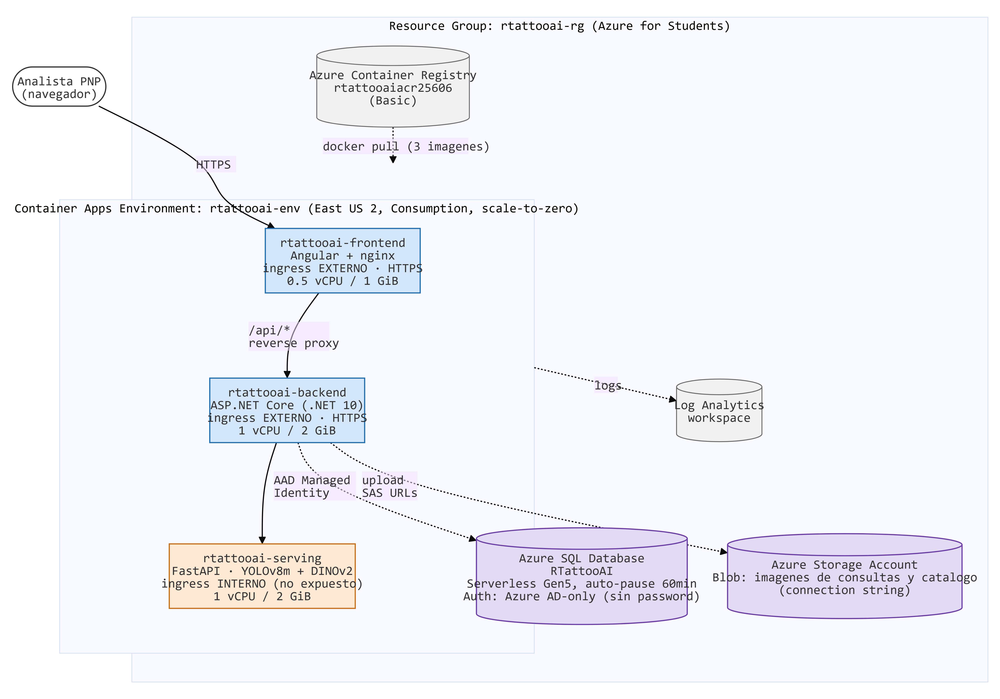

# RTattooAI — ML (Detección + Identificación de Tatuajes)

Repositorio de **Machine Learning** del proyecto **RTattooAI**: un sistema de
reconocimiento de tatuajes por visión por computadora para apoyar a la
**Policía Nacional del Perú (PNP)** en la identificación preliminar de tatuajes
asociados a bandas organizadas.

> ⚠️ **Es una herramienta de apoyo al análisis preliminar, no un sistema de
> identificación definitiva.** Toda salida debe interpretarse como una
> sugerencia que requiere validación humana.

El sistema tiene **dos etapas de IA**, ambas implementadas y medidas:

1. **Detección (YOLOv8)** — localiza el tatuaje en la imagen (bounding box).
   Una sola clase: `tatuaje`.
2. **Identificación (DINOv2 + cabeza afinada + galería)** — recorta el
   tatuaje detectado, extrae un embedding y lo compara por similitud coseno
   contra una galería de tatuajes de bandas conocidas, con rechazo open-set
   (umbral + margen). Ver [`src/embedding/`](src/embedding/).

Ambas etapas se exponen juntas a través de un microservicio FastAPI
(`serving/`) desplegado en Azure Container Apps, que es el que consume el
backend en ASP.NET Core (otro repositorio). Este repo entrena los modelos,
los exporta (ONNX para el detector, `.pt` para la cabeza del embedder) y
contiene el servicio que los sirve.

Este repositorio es uno de los tres que componen el sistema completo. Ver
[Repositorios relacionados](#repositorios-relacionados).

---

## 📊 Estado actual (honesto)

| Etapa | Estado |
|-------|--------|
| Estructura del repo, scripts, documentación | ✅ Completo |
| Toolchain (PyTorch CUDA + Ultralytics) verificado en GPU | ✅ Verificado (RTX 3070 Ti, 8 GB) |
| Descarga de datasets (Roboflow) | ✅ 8 fuentes (~21.8k crudas) |
| Unificación + dedup (7006 imgs únicas) | ✅ [reports/dataset_summary.md](reports/dataset_summary.md) |
| DeMSI (FER/Zagreb) | ⛔ **Descarga manual** (login al repositorio FER) — ver TODO abajo |
| Entrenamiento detección (yolov8m + yolov8s, 150 épocas) | ✅ Completado en GPU |
| Evaluación + reportes de detección | ✅ [reports/metrics.md](reports/metrics.md) |
| Exportación ONNX del detector | ✅ `models/yolov8m_best.onnx` (opset 12) |
| Identificación: DINOv2 + galería + cabeza afinada | ✅ Ver [§ Identificación](#-identificación-por-embeddings-dinov2) |
| Pipeline Blender (galería sintética/multi-vista) | ✅ Ver [`blender/`](blender/) |
| Microservicio de inferencia (`serving/`) | ✅ Desplegado en Azure Container Apps |
| Validación con fotos reales a escala (~20-30 fotos etiquetadas) | ⛔ Pendiente — solo N=6 preliminar, ver [§ Identificación](#-identificación-por-embeddings-dinov2) |

> **Resultado (modelo definitivo `yolov8m`, split test held-out):
> mAP@0.5 = 0.915, precisión = 0.889** → **cumple la meta** (mAP@0.5 > 0.85,
> precisión ≥ 0.80) y **supera el baseline** Pocevičė 2024 (0.79). Métricas
> reales y reproducibles (semilla 42), no fabricadas. Tabla completa val/test
> en [reports/metrics.md](reports/metrics.md). **Pendiente:** integrar DeMSI
> (manual) y poblar `datasets/real_test/` para la brecha sim-to-real.

### 🔓 Para desbloquear

1. **Roboflow** (obligatorio para el dataset): obtén tu API key en
   <https://app.roboflow.com> → *Settings → API Keys*. Dos opciones (no la
   commitees nunca):
   - **Recomendada — archivo `.env`:** copia `.env.example` a `.env` y pega la
     clave. Los scripts lo cargan solos (`src/shared/env.py` + python-dotenv).
     ```
     ROBOFLOW_API_KEY=tu_clave_aqui
     ```
   - **Variable de entorno** (PowerShell, persistente; reabre la terminal):
     ```powershell
     setx ROBOFLOW_API_KEY "tu_clave_aqui"
     ```

2. **DeMSI** (opcional pero recomendado — es el baseline de la referencia):
   el dataset no tiene descarga pública (está tras el login del repositorio
   DeMSI en FER). Solicita acceso en
   <https://www.fer.unizg.hr/demsi/databases_and_code/tattoo_dataset>,
   coloca imágenes + anotaciones en `datasets/raw/demsi/` y vuelve a correr
   `prepare_dataset.py` (convierte sus polígonos a bounding boxes
   automáticamente). **TODO del equipo.**

---

## 🗂️ Estructura

```
rtattooai-ml/
├── README.md
├── requirements.txt
├── .gitignore                # ignora datasets/, models/, runs/, *.pt, *.onnx, venv
├── data.yaml                 # plantilla de config (1 clase: tatuaje)
├── src/
│   ├── detection/            # Etapa 1: YOLOv8
│   │   ├── download_data.py      # descarga Roboflow (+ chequeo DeMSI)
│   │   ├── prepare_dataset.py    # unifica a YOLO 1 clase, dedup, splits
│   │   ├── train.py              # entrenamiento yolov8m + yolov8s
│   │   ├── evaluate.py           # métricas + reportes
│   │   └── export_onnx.py        # exportación a ONNX
│   ├── embedding/            # Etapa 2: DINOv2 + galería + cabeza afinada
│   │   ├── embedder.py           # extractor DINOv2 + cabeza opcional
│   │   ├── build_gallery.py      # construye la galería multi-vista
│   │   ├── identify.py           # identifica un tatuaje en una imagen
│   │   ├── finetune_head.py      # fine-tuning contrastivo de la cabeza
│   │   ├── calibrate.py          # calibra umbral + margen con fotos reales
│   │   └── robustness_test.py    # robustez a degradación
│   └── shared/               # paths, seeds, helpers de métricas
├── blender/                  # Generación sintética de vistas (galería)
├── serving/                  # Microservicio FastAPI (detección + identificación)
├── app/                      # Demos Streamlit
├── datasets/  (gitignored)
│   ├── raw/                  # cada fuente descargada sin tocar
│   ├── unified/               # dataset fusionado final (YOLO) + data.yaml
│   ├── gang_tattoos/          # diseños limpios de la galería de bandas
│   └── real_test/             # imágenes reales del contexto peruano (vacío)
├── models/    (gitignored)   # yolov8m_best.onnx, embed_head.pt, gallery_dinov2.npz
├── notebooks/
└── reports/                  # métricas, curvas PR/CMC, ablaciones, validación real
```

---

## ⚙️ Setup

**Requisitos:** Windows/Linux, **GPU NVIDIA con CUDA** y Python 3.11–3.14.
Entorno **verificado** en este repo: Windows 11, **RTX 3070 Ti (8 GB)**,
Python 3.14.3, torch 2.11.0+cu128 (ver [`reports/environment_check.md`](reports/environment_check.md)).

```powershell
# 1) Entorno virtual
py -m venv venv
.\venv\Scripts\Activate.ps1        # Linux/Mac: source venv/bin/activate

# 2) PyTorch con CUDA (IMPORTANTE: instalar la build CUDA primero)
#    Python 3.14 -> usar cu128 (cu124 no tiene wheels para cp314):
pip install torch torchvision --index-url https://download.pytorch.org/whl/cu128
#    Python 3.11-3.13 -> cu124 también sirve.

# 3) Resto de dependencias
pip install -r requirements.txt

# 4) Verificar GPU
python -c "import torch; print('CUDA:', torch.cuda.is_available(), torch.cuda.get_device_name(0) if torch.cuda.is_available() else '')"
```

> Si `torch.cuda.is_available()` es `False`, revisa drivers/CUDA. El
> entrenamiento **no** corre en CPU por política del proyecto.
>
> **Windows + Python 3.14:** Ultralytics usa *workers* multiproceso en el
> DataLoader; en Windows esto exige el guard `if __name__ == "__main__":`
> (todos los scripts de este repo lo tienen). Ejecútalos siempre como módulo
> (`python -m src.detection.train`), no copiando su contenido suelto.

---

## ▶️ Cómo ejecutar

Todos los scripts se ejecutan como módulos desde la raíz del repo:

```powershell
# 1) Descargar fuentes (requiere ROBOFLOW_API_KEY)
python -m src.detection.download_data            # o --list para ver fuentes
                                                 # o --skip-optional

# 2) Unificar a un único dataset YOLO de 1 clase (dedup + splits 80/10/10)
python -m src.detection.prepare_dataset          # genera datasets/unified/ + reports/dataset_summary.*

# 3) Entrenar (modelo definitivo yolov8m + baseline yolov8s)
python -m src.detection.train                    # GPU obligatoria

# 4) Evaluar y generar reportes (mAP, PR, matriz de confusión, grilla)
python -m src.detection.evaluate

# 5) Exportar a ONNX
python -m src.detection.export_onnx
```

Reproducibilidad: todos los scripts fijan **semilla 42** (`src/shared/seeds.py`).

---

## 🧱 Estrategia del dataset

No se usa un solo dataset pequeño: se **fusionan varias fuentes públicas** de
detección de tatuajes en un único dataset YOLO de **una sola clase**.

`prepare_dataset.py`:
- Normaliza todas las anotaciones a la clase `0 = tatuaje`.
- Convierte **polígonos/máscaras de segmentación a bounding boxes** (min/max).
- **Deduplica** imágenes casi idénticas entre fuentes con **hash perceptual**
  (`imagehash.phash` + LSH por bandas) para evitar fuga train/test.
- Re-divide en **train/val/test 80/10/10** con semilla fija.
- Genera `datasets/unified/data.yaml` y la tabla de procedencia en
  [`reports/dataset_summary.md`](reports/).

### Fuentes (procedencia)

| Fuente | Tipo | Imágenes (aprox.) | Procedencia |
|--------|------|-------------------|-------------|
| Lance Nelson (ARTAT) | detección | ~1.33k | [Roboflow](https://universe.roboflow.com/lance-nelson-gtmdt/artat) |
| Xisketos (Detección de Tatuajes) | detección | ~1.33k | [Roboflow](https://universe.roboflow.com/xisketos/deteccion-de-tatuajes) |
| by tatoo (Tattoo Detection) | detección | ~603 | [Roboflow](https://universe.roboflow.com/tatoo-9syny/tattoo-detection-qia5k) |
| Code with Heady (Tattoo Detection-Updated) | detección | ~561 | [Roboflow](https://universe.roboflow.com/code-with-heady-5wdhf/tattoo-detection-updated) |
| Playground (TattooTest) | segmentación → bbox | ~5.19k | [Roboflow](https://universe.roboflow.com/playground-xxvvy/tattootest-utzal) |
| G. Pocevičė (loc. & recognition)* | detección | — | [Roboflow](https://universe.roboflow.com/gabijapocevicemajor-7dvfl/tattoo-localization-and-recognition) |
| DeMSI (FER/Zagreb)* | polígonos → bbox | ~890 | [FER](https://www.fer.unizg.hr/demsi/databases_and_code/tattoo_dataset) — **descarga manual** |

\* Opcionales / pendientes. **Las licencias de cada proyecto de Roboflow deben
verificarse en su página** (Roboflow Universe varía entre CC-BY, MIT, etc.);
documentarlas en el informe (Hito 7). La tabla con conteos reales (imágenes,
cajas, duplicados) se genera en `reports/dataset_summary.csv` al ejecutar
`prepare_dataset.py`.

**Meta de tamaño:** el mayor dataset limpio posible (~6–10k imágenes; los
datasets públicos de tatuajes son cada uno < 10k).

---

## 🎯 Metas y comparación

| Referencia | mAP@0.5 |
|------------|---------|
| **Baseline** — Pocevičė et al., 2024 (YOLOv5 sobre DeMSI) | 0.79 |
| **Meta de la tesis** | **> 0.85** (y precisión ≥ 0.80) |

### Resultados obtenidos (reales, seed 42)

Dataset unificado: **7006 imágenes / 8619 cajas** (train 5604 / val 701 / test 701).
Entrenamiento en RTX 3070 Ti (8 GB), batch auto = 3, imgsz 640.

| Modelo | Split | mAP@0.5 | mAP@0.5:0.95 | Precisión | Recall |
|--------|-------|---------|--------------|-----------|--------|
| **yolov8m** (definitivo) | val | 0.924 | 0.718 | 0.931 | 0.875 |
| **yolov8m** (definitivo) | **test** | **0.915** | **0.681** | **0.889** | **0.866** |
| yolov8s (baseline) | val | 0.916 | 0.701 | 0.891 | 0.880 |
| yolov8s (baseline) | test | 0.923 | 0.681 | 0.893 | 0.873 |

✅ **Meta cumplida:** `yolov8m` en test alcanza **mAP@0.5 = 0.915 > 0.85** y
**precisión = 0.889 ≥ 0.80**, y **supera el baseline 0.79**. val ≈ test (0.924
vs 0.915) → sin overfitting ni fuga. Curvas PR, matrices de confusión y grilla
de predicciones en [`reports/`](reports/); tabla en
[reports/metrics.md](reports/metrics.md).

`evaluate.py` reporta mAP@0.5, mAP@0.5:0.95, precisión y recall en **val** y
**test**, y emite un veredicto explícito de si se cumple la meta. La métrica
sobre `datasets/real_test/` (imágenes peruanas reales) se reporta **por
separado** como medida de la brecha sim-to-real.

### Generalización cross-dataset (DeMSI) — brecha de dominio

Evaluación **zero-shot** del modelo (entrenado solo con las fuentes Roboflow)
sobre las **890 imágenes de DeMSI** (1840 cajas), que **no** se usaron en el
entrenamiento. Reporte en [reports/metrics_demsi.md](reports/metrics_demsi.md).

| Modelo | Conjunto | mAP@0.5 | mAP@0.5:0.95 | Precisión | Recall |
|--------|----------|---------|--------------|-----------|--------|
| yolov8m | test propio (in-distribution) | 0.915 | 0.681 | 0.889 | 0.866 |
| yolov8m | **DeMSI (cross-dataset)** | **0.557** | 0.390 | 0.823 | 0.517 |

**Lectura honesta:** hay una **caída de dominio** clara (0.915 → 0.557). No es
comparable de forma directa con el baseline 0.79 de Pocevičė: **ellos
entrenaron sobre DeMSI** y nosotros lo evaluamos en frío. La precisión se
mantiene alta (0.82) y el modelo detecta ≥1 tatuaje en el **95.7%** de las
imágenes (ver [reports/external_demsi/](reports/external_demsi/)), pero el
**recall baja a 0.52**: DeMSI etiqueta **varios tatuajes pequeños y ajustados
por imagen** y el modelo tiende a marcar la región principal, perdiendo los
secundarios (de ahí también el mAP@0.5:0.95 más bajo). **Conclusión para el
despliegue:** para acercarse al dominio real conviene **incluir DeMSI (y las
imágenes peruanas) en el entrenamiento**, no solo en evaluación.

Herramientas: `prepare_external.py` (convierte un set externo anotado a YOLO) y
`predict_folder.py` (inferencia cualitativa sobre una carpeta sin anotaciones).

---

## 🚀 Entrenamiento (parámetros)

- Modelo definitivo: **`yolov8m`** (transfer learning desde COCO).
- Baseline ligero: **`yolov8s`** (para la tabla comparativa).
- `imgsz=640`, `epochs=150`, `patience=30`, `batch=-1` (auto), **semilla 42**.
- Augmentations por defecto de Ultralytics, con **`flipud=0`** (un tatuaje
  boca abajo es poco natural).

---

## 📦 Exportación ONNX y consumo desde .NET

`export_onnx.py` exporta `best.pt` a ONNX y lo verifica con ONNX Runtime.

- **Opset:** 12 (compatible con ML.NET / ONNX Runtime).
- **Entrada:** `1 x 3 x 640 x 640` (NCHW, `float32`, RGB normalizado 0–1).
- **Salida:** tensor de detecciones YOLOv8 `[1, 5, 8400]`
  (`x, y, w, h, score` por ancla; 1 clase).
- **Postproceso en el backend:** aplicar **NMS** (p. ej. `conf ≥ 0.25`,
  `iou ≥ 0.45`) y reescalar las cajas al tamaño original de la imagen.

### Consumo en ASP.NET Core (ONNX Runtime / ML.NET)

```csharp
using Microsoft.ML.OnnxRuntime;
using Microsoft.ML.OnnxRuntime.Tensors;

using var session = new InferenceSession("yolov8m_best.onnx");

// Preprocesado: redimensionar a 640x640, BGR->RGB, /255, layout NCHW
var input = new DenseTensor<float>(new[] { 1, 3, 640, 640 });
// ... rellenar input con los píxeles normalizados ...

var inputs = new List<NamedOnnxValue> {
    NamedOnnxValue.CreateFromTensor("images", input)
};
using var results = session.Run(inputs);
var output = results.First().AsTensor<float>(); // [1, 5, 8400]
// Postproceso: parsear cajas, filtrar por score, aplicar NMS, reescalar.
```

> El nombre exacto del tensor de entrada (`images`) y de salida se imprime al
> correr `export_onnx.py`; úsalos tal cual en el backend.

---

## 🔎 Identificación por embeddings (DINOv2)

Segunda etapa: toma el recorte que produjo YOLOv8 y decide a qué tatuaje de
la galería de bandas se parece, o si no se parece a ninguno (`no_match`).

- **Extractor:** DINOv2 ViT-S/14, con una **cabeza contrastiva afinada**
  (MLP 384→256→128, `src/embedding/finetune_head.py`) que mejora la
  invarianza a estilo/degradación sobre el embedding crudo.
- **Galería:** 25 tatuajes de banda × ~17 vistas cada uno (diseño limpio +
  vistas sintéticas generadas con Blender). La similitud de una identidad es
  el coseno máximo entre sus vistas.
- **Veredicto:** `match` si la mejor similitud supera el **umbral (0.55)** y
  además supera a la segunda mejor por el **margen (0.05)** — si no, `no_match`,
  devolviendo igual el top-K más cercano para que la persona lo revise.

### Resultados (galería de producción, ver [resumen completo](reports/resumen_modelos_pipeline.md))

| Configuración | Top-1 (sintético) | Coseno genuino medio |
|---|---:|---:|
| DINOv2 solo, galería de un solo diseño | 94% | 0.71 |
| + galería multi-vista (Blender) | 100% | 0.81 |
| + cabeza afinada (actual) | ~99% | 0.88 |

| Métrica (galería actual, 500 consultas sintéticas) | Valor |
|---|---:|
| Top-1 / Top-5 / Top-10 | 98.2% / 99.4% / 100% |
| mAP de retrieval | 0.988 |
| FAR / FRR @ ρ=0.55 (operación) | 0.0% / 11.8% |
| Robustez: top-1 con 60% de degradación | 90% |

**Por qué estos números no cierran la historia:** son sobre consultas
**sintéticas** (variaciones 2D de los mismos diseños ya vistos en la
galería) — funcionan como sanity-check del espacio de embeddings, casi un
techo, no como precisión de campo. La primera validación con **fotos reales
(N=6)**, incluido un collage de prensa real de tatuajes de Tren de Aragua,
dio 3/3 negativos correctamente rechazados y 5/5 símbolos icónicos
identificados (estrella, corona, AK-47, reloj, locomotora); falló 1/2 fotos
de estilo muy distinto al diseño de catálogo. Detalle completo en
[reports/real_photo_validation.md](reports/real_photo_validation.md).
**Pendiente:** validar con ~20-30 fotos reales etiquetadas para una
estimación de precisión en campo, no solo sintética.

### Pipeline Blender (galería sintética)

[`blender/`](blender/) genera vistas realistas de cada tatuaje (distinta
zona del cuerpo, tono de piel, ángulo e iluminación) para enriquecer la
galería de identificación — no aporta a la detección, sino a que el
embedder reconozca el mismo diseño en condiciones distintas. Guía paso a
paso en [blender/README.md](blender/README.md) y
[blender/GUIA_DESDE_CERO.md](blender/GUIA_DESDE_CERO.md).

## 🧩 Servicio de inferencia (`serving/`)

Microservicio **FastAPI** que envuelve ambas etapas (YOLOv8m ONNX +
DINOv2 + cabeza + galería) detrás de un contrato HTTP simple
(`/health`, `/identify`, `/enroll`) — es lo que consume el backend
ASP.NET Core. Desplegado como contenedor interno (sin exponer a internet)
en Azure Container Apps, junto al backend y frontend. Detalle completo,
variables de entorno y ejemplos de `curl` en
[serving/README.md](serving/README.md).

---

## 🖥️ Demo interactiva (Streamlit)

Probar el modelo con imágenes propias o **una foto tomada al momento** con la cámara:

```powershell
streamlit run app/streamlit_app.py
```

Abre `http://localhost:8501`. Pestañas **Subir imagen** y **Tomar foto** (cámara
del navegador). En la barra lateral se ajustan confianza e IoU. Para usar la
**cámara del celular**, abre en el teléfono la *Network URL* que imprime
Streamlit (mismo WiFi, p. ej. `http://192.168.x.x:8501`).

**Flujo completo (detección + identificación):**
```powershell
streamlit run app/streamlit_full.py
```
Detecta el tatuaje, lo recorta, saca su embedding (DINOv2) y muestra el **top-K
de la galería de bandas** con su similitud y un veredicto ("posible banda X" /
"ninguna conocida"). Requiere `models/gallery_dinov2.npz` (genera con
`python -m src.embedding.step0_baseline`). Consulta por CLI:
`python -m src.embedding.identify --image foto.jpg`.

> Es una demo de **apoyo preliminar**: muestra cajas y confianzas; no es
> identificación definitiva.

---

## 🔁 Reproducibilidad

- Semilla global **42** en descarga, preparación, splits y entrenamiento.
- `cudnn.deterministic = True` durante el entrenamiento.
- El split train/val/test es determinista dada la misma semilla y fuentes.

---

## 🏗️ Arquitectura de despliegue

El servicio de inferencia (`serving/`) corre como contenedor **interno** (sin
exponer a internet) en Azure Container Apps, junto al backend y al frontend.
Diagrama completo:



## Repositorios relacionados

| Repo | Contenido |
|------|-----------|
| [`rtattooai-backend`](https://github.com/RTattooAI/rtattooai-backend) | API ASP.NET Core que consume el servicio `serving/` de este repo |
| [`rtattooai-frontend`](https://github.com/RTattooAI/rtattooai-frontend) | Cliente Angular usado por los analistas |

El contrato de API entre los tres repos vive en
[`serving/API_CONTRACT.md`](serving/API_CONTRACT.md) (sección A: contrato del
servicio de inferencia; las secciones B/C/D del contrato backend↔frontend
están espejadas en los otros dos repos).

---

## 📝 Próximos pasos

1. Validar la identificación con **~20-30 fotos reales etiquetadas** (la
   evidencia actual es N=6 preliminar + métricas sintéticas, ver
   [§ Identificación](#-identificación-por-embeddings-dinov2)).
2. Integrar **DeMSI** (descarga manual) en el *entrenamiento* del detector,
   no solo en evaluación cross-dataset, para cerrar la brecha de dominio
   (0.915 → 0.557 en zero-shot, ver [reports/metrics_demsi.md](reports/metrics_demsi.md)).
3. Poblar `datasets/real_test/` con imágenes peruanas reales y reportar la
   brecha sim-to-real de forma sistemática.
4. Medir la latencia del `serving/` real desplegado en Azure (hoy solo hay
   benchmark local, ver [reports/serving_latency_local.md](reports/serving_latency_local.md)).
